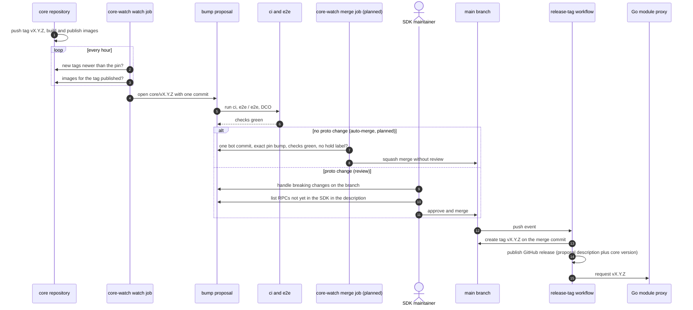
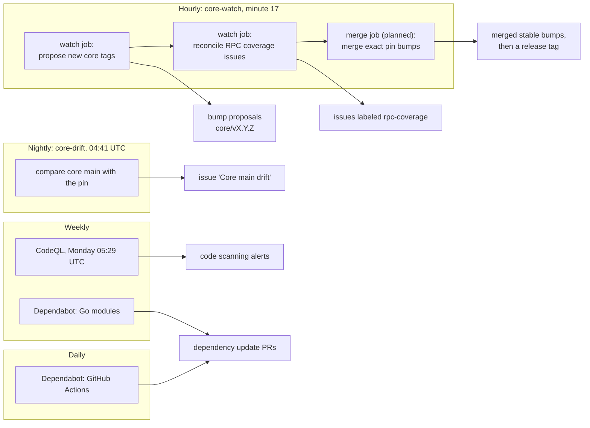

# Releasing the OpenShell Go SDK

> [!WARNING]
> This guide describes the release process as it works once the auto-merge rollout is finished.
> Everything marked "(planned)" is not live yet:
>
> - The core-watch `merge` job and its merge-only GitHub App, which merge stable core bumps that change no proto without review (planned).
> - A ruleset that lets only the bump App and maintainers write `core/*` branches (planned).
> - A ruleset on `main` that requires `ci`, `e2e / e2e`, and `DCO` with no bypass (planned).
> - The repository variable `CORE_AUTO_MERGE=on` that switches the merge job on (planned).
> - The `hold` label that keeps a proposal away from the merge job (planned).
>
> Until then, a maintainer reviews and merges every bump proposal by hand.
> GitHub enforces only the `DCO` check and one code-owner review; `ci` and `e2e` run on every proposal, but a failing run doesn't block the merge button.
> The rollout is tracked in [#88](https://github.com/ai-openshell/sdk-go/issues/88).

## In one minute

The Go SDK follows OpenShell core in lockstep: SDK `vX.Y.Z` is generated from core `vX.Y.Z`, and there are no SDK-only releases.
Every hour, a workflow looks for new core tags and opens a pull request that moves the SDK's pin to the new tag and regenerates the bindings.
If a stable release changes nothing in the protos, that pull request merges itself once its checks pass (planned).
If it does change the protos, an SDK maintainer reviews it, adds whatever SDK code the release needs, and merges it.
Merging a stable pin to `main` tags the SDK release without anyone typing a version number.
Two more mechanisms track the gap between core and the SDK: a nightly job compares core's `main` branch with the pin, and the SDK keeps one GitHub issue for every core RPC it doesn't wrap yet.
The infra team owns the workflows and the scripts that run with bot tokens; the SDK team owns the SDK code and decides when a release that changes the protos is ready.

## Concepts and terms

| Term | Meaning |
|------|---------|
| Core | OpenShell itself, in [ai-openshell/openshell](https://github.com/ai-openshell/openshell). It defines the gRPC API in its `proto/` directory and publishes the gateway, supervisor, and sandbox images. |
| Pin | The core tag the SDK is built from: `inputs[0].tag` in [`buf.gen.yaml`](buf.gen.yaml). `mise run core:version` prints it. |
| Bindings | The Go code that `buf` generates from core's protos into [`proto/`](proto/). Nobody edits these files by hand. |
| Bump proposal | The pull request that moves the pin to a new core tag, on a branch named `core/<tag>`, labeled `core-bump` plus `stable` or `prerelease`. |
| Stable and pre-release tags | Core tags look like `v0.1.10` (stable) or `v0.1.10-pre.2` (pre-release). A pre-release sorts below its stable version. |
| Lockstep release | The SDK tag `vX.Y.Z` that the `release-tag` workflow creates when a stable pin lands on `main`. |
| Drift | Differences between core's `main` branch and the pinned tag that the SDK will have to handle in a future release. |
| RPC coverage issue | A GitHub issue, labeled `rpc-coverage`, for a user-facing core RPC (or a whole service) that the SDK doesn't wrap yet. |
| Bump App | The `ai-openshell-sdk-go` GitHub App. The automation uses its token to push `core/*` branches, open pull requests, manage issues, and create tags. |
| Merge App (planned) | A second GitHub App that only merges. It is the only identity allowed to skip the code-owner review on `main`. |
| `sdk-bot` environment | The GitHub environment that holds the bump App's secrets, and the merge App's (planned). Only workflows running on `main` can use it, so a pushed branch can't get a bot token. |

## Versioning

SDK versions mirror core versions exactly.
SDK `v0.1.10` contains bindings generated from core `v0.1.10`, and its release notes end with "Matches OpenShell core v0.1.10".
An SDK fix that lands between two core releases ships with the next core release.

Pre-release core tags get bump proposals too, so the SDK can be tested against them early, but merging a pre-release pin never creates an SDK tag.
When core publishes a newer pre-release, its proposal replaces the older one.

There is no SDK-only version, and there is no clean way to number one.
Picking `v0.1.11` would take the version core's next release needs.
A suffix such as `v0.1.10-sdk.1` is a semver pre-release, which Go sorts below `v0.1.10`, so `go get` would never choose it.
Build metadata such as `v0.1.10+sdk.1` is ignored by Go modules entirely.
If a published SDK version turns out to be broken, see [A broken release](#a-broken-release).

While the SDK is on `v0.x`, its quality bar is deliberately pragmatic, so that the release train keeps moving:

- Breaking proto changes must be handled before a release merges.
- New user-facing RPCs may follow in a later release, as long as the release notes list them.
- A release that changes the protos needs green CI and E2E plus one review from the `sdk` team.
  One that doesn't change them merges without review once the same checks pass (planned).

Expect that bar to rise on the way to `v1`.

## The release flow

A release starts in core, not here.
When core pushes a new tag, the hourly [core-watch](.github/workflows/core-watch.yml) workflow picks it up and its `watch` job opens a bump proposal.
Core creates the tag before its release build finishes, so core-watch waits until the gateway, supervisor, and sandbox images for that tag exist; until then it skips the tag and tries again on the next run.
The proposal branch `core/vX.Y.Z` holds exactly one commit, `chore(core): track vX.Y.Z`, which moves the pin, regenerates the bindings, refreshes the vendored conformance fixtures, and, for stable tags, updates the core version named in the README.
Its description shows the compare link to the previous core tag, which generated files changed, the gateway image E2E runs against, and the proto diff.

From there, the release takes one of two paths.
What decides the path is whether the generated bindings in `proto/` change.
The proto diff in the description covers all of core's protos, including ones the SDK doesn't generate, so a release can show a diff there and still take the first path.

**No proto change.**
The regenerated bindings are identical, so the SDK needs no work.
The core-watch `merge` job (planned) runs as a separate merge-only App and merges the proposal once all of these hold:

- It is still the bot's single commit.
- The commit contains nothing but the pin and the README line.
- `ci`, `e2e / e2e`, and `DCO` have passed.
- Nothing else is failing or pending.
- Nobody has added the `hold` label.

The job rebuilds the expected change from the merge base with `main` and compares whole trees, so even an extra line inside `buf.gen.yaml` sends the proposal back to review.
It leaves a comment saying why it merged without a human review.
Because the merge job (planned) runs every hour, a stable SDK release follows within about two hours after core's images are published.

**Proto change.**
A maintainer reviews the proposal.
Breaking changes have to be handled before merging, by pushing SDK commits to the same `core/vX.Y.Z` branch.
The v0.1.10 proposal, for example, added converters for new policy fields.
New RPCs don't have to be wrapped yet, but the proposal's description must list the ones that aren't, because that description becomes the release notes (see the [runbook](#runbook-releasing-a-core-version)).
One approving review from the `sdk` team and green checks are enough to merge.

Either way, the merge reaches `main`, and the [release-tag](.github/workflows/release-tag.yml) workflow takes over.
It compares the pin before and after the push.
When a stable pin changed, it creates the lightweight tag `vX.Y.Z` on the merge commit, publishes a GitHub release whose body is the merged proposal's description plus "Matches OpenShell core vX.Y.Z", and asks the Go module proxy to fetch the new version so `go get` finds it right away.
Each of those steps runs only when its result is missing, so re-running the workflow after a partial failure finishes the job without duplicating anything.



Pre-releases follow the first half of the same flow.
A pre-release proposal runs CI and E2E against the pre-release images and can be merged to test the SDK early, but `release-tag` creates nothing for a pre-release pin.
A newer pre-release closes the older proposal.

## The recurring updates

Most of the process runs on a schedule, so nobody has to remember to check core for news.
The chart shows what runs when and what each job leaves behind for a human to look at.



- **core-watch** (every hour at minute 17): the `watch` job proposes new core tags and then reconciles the RPC coverage issues; the reconcile step runs even when proposing failed.
  The `merge` job (planned) runs after it.
  You can start core-watch by hand from the Actions tab, optionally for one specific `tag`.
- **core-drift** (every night at 04:41 UTC): compares core's `main` branch with the pin and updates a single issue.
- **CodeQL** (every Monday at 05:29 UTC, plus every pull request and push to `main`): static analysis of the Go code.
- **Dependabot**: weekly pull requests for Go modules, daily ones for GitHub Actions; see [Dependencies](#dependencies).

When a scheduled job fails, it records a dated line in the `Core main drift` issue under "Automation failures", one line per job and day with a counter for repeated failures.
That issue is the place to look when something seems stuck.

## Proto drift and missing functionality

Two different questions matter between releases: will the next core release break the SDK, and which parts of core are still out of reach for SDK users?
The drift check answers the first, the RPC coverage issues the second.

### The drift check

Every night, [`drift-check.sh`](hack/automation/drift-check.sh) compares core's `main` branch with the pinned tag in three steps:

1. `buf breaking` checks the proto files the SDK generates for breaking changes.
2. The bindings are regenerated from core's `main` in a temporary worktree, then the SDK is built and vetted against them.
3. The regenerated stubs are scanned for RPCs the SDK doesn't call. This step is informational and never fails the check.

The result goes into one issue titled `Core main drift`, labeled `core-drift`.
While a check fails or automation failures are pending, the issue stays open and its body shows the latest report; uncovered RPCs in it link to their coverage issues.
Once both checks pass and the failure list is empty, the issue closes itself with a comment.
A red drift check is an early warning, not a blocker: core's `main` may break the SDK long before core tags a release with that change, and the SDK team can prepare in the meantime.

### RPC coverage issues

After proposing tags, every core-watch run reconciles one GitHub issue per user-facing core RPC that the SDK doesn't wrap yet, so every gap is visible and comes with a ready implementation brief.
The current set for core v0.1.10 is [#78](https://github.com/ai-openshell/sdk-go/issues/78) to [#86](https://github.com/ai-openshell/sdk-go/issues/86).

- **Which RPCs count:** the automation reads core's protos at the newest core tag, stable or pre-release.
  An RPC is user-facing when its authorization annotation allows bearer tokens.
  Plugin and driver protos, and sandbox, peer, supervisor, operator, and unauthenticated RPCs never get issues.
- **When an RPC is covered:** a package under `openshell/v1` (tests and fakes excluded) creates the service's client and calls the method, directly or by passing it to a helper.
- **One issue per method or per service:** when the SDK wraps none of a service's methods, one issue tracks the whole service; otherwise each missing method gets its own issue.
- **Labels:** every issue carries `rpc-coverage` and `help wanted`, plus `rpc:ready` when the current `main` already has the generated bindings, or `rpc:blocked` when it has to wait for a newer pin.
- **Lifecycle:** each run opens missing issues, rewrites bodies and labels that changed, and closes an issue with a reason once the method is covered, removed, excepted, or no longer user-facing.
  It reopens issues it closed itself when they apply again.
  An issue a maintainer closes stays closed, and an issue a maintainer reopens is never closed as covered again.
- **Exceptions:** to keep an RPC out of the SDK on purpose, add a line `Service.Method  reason` to [`rpc-exceptions.txt`](hack/automation/rpc-exceptions.txt); the next run closes its issue with that reason.
- **Safety limit:** a run that would open more than 10 issues stops before writing anything.
  If that many are expected, run core-watch by hand with the input `max_new_issues`.

To pick one up, open the issue: its body describes the RPC, links its proto definition and core's server code, and ends with an implementation brief you can use as the task description.
The pull request that wraps the RPC closes the issue automatically on the next core-watch run.

The full rules, including the issue marker and how text from core is sanitized, are in the [automation README](hack/automation/README.md#rpc-coverage-issues).

## CI jobs

Every workflow lives in [`.github/workflows/`](.github/workflows/).
"Runs as" says whose token a job uses: `GITHUB_TOKEN` is the short-lived token GitHub gives every run, and [Who can change what](#who-can-change-what) describes the bump App and the merge App (planned).
"Required" says whether GitHub refuses to merge a pull request when the check fails.

| Workflow / job | Trigger | What it does | Runs as | Required |
|----------------|---------|--------------|---------|----------|
| `ci` / `ci` | pull request, push to `main`, manual | License headers, then `mise run ci`: formatting, lint, build, unit tests, a check that `proto/` matches the pin, a check that the conformance fixtures match core, and a check that every public package has a docs page. | `GITHUB_TOKEN` | yes (planned) |
| `ci` / `workflows` | same | `mise run workflows:check`: actionlint, zizmor, shellcheck, and the offline tests of the automation scripts. | `GITHUB_TOKEN` | no |
| `ci` / `changes` | pull request | Decides whether the pull request needs E2E: it does when it touches the pin, `go.mod`, `mise.toml`, `proto/`, `openshell/`, `e2e/`, the gateway scripts, or the E2E workflow. | `GITHUB_TOKEN` | no |
| `ci` / `e2e` (shown as `e2e / e2e`) | pull request, when `changes` says so | Starts the published core gateway for the pinned version with Docker and runs the E2E suite against it. Every bump proposal runs it. | `GITHUB_TOKEN` | yes (planned), see the note under [Rules on `main`](#rules-on-main) |
| `e2e` / `e2e` | called by `ci`, manual with input `core-version` | The E2E lane itself; run it by hand to test the SDK against another core version. | `GITHUB_TOKEN` | no |
| `CodeQL` / `analyze` (shown as `CodeQL (go)`) | pull request, push to `main`, Monday 05:29 UTC, manual | Static analysis of the Go code. | `GITHUB_TOKEN` | no |
| `docs` / `build`, `deploy` | pull request touching `docs/`, `mise.toml`, `mise.lock`, or the docs workflow, push to `main`, manual | Builds the mdbook site; on `main` it deploys to GitHub Pages. | `GITHUB_TOKEN` | no |
| `core-watch` / `watch` | every hour at minute 17, manual with inputs `tag` and `max_new_issues` | Proposes new core tags and reconciles the RPC coverage issues. | bump App | no |
| `core-watch` / `merge` (planned) | after `watch`, only when `CORE_AUTO_MERGE` is `on` | Merges stable proposals that are an exact pin bump with green checks. Runs no generator and no code from core. | merge App (planned) | no |
| `core-drift` / `drift` | every night at 04:41 UTC, manual | Compares core's `main` with the pin and updates the `Core main drift` issue. | bump App | no |
| `release-tag` / `tag` | push to `main`, manual with input `sha` | Creates the tag, the GitHub release, and the Go proxy request when a stable pin changed. | bump App | no |
| `DCO` (GitHub App, not a workflow) | pull request | Checks that every commit carries a `Signed-off-by` line. | DCO App | yes |

Every job that uses a bot token also has a failure step that records the failed run in the `Core main drift` issue.

## Who can change what

The rules follow one idea: the infra team guards everything that runs with a bot token, and the SDK team owns the SDK code and decides when a release that changes the protos is ready.
The automation can open pull requests and, for exact pin bumps, merge them (planned), but it never changes SDK code on its own.

### Code owners

[`CODEOWNERS`](.github/CODEOWNERS) decides whose review a pull request needs:

| Path | Code owners | Why |
|------|-------------|-----|
| everything not listed below | `@ai-openshell/sdk` or `@ai-openshell/maintainers` | The SDK team owns the SDK; OpenShell maintainers review as a fallback. |
| `.github/` | `@ai-openshell/infra` | Workflows decide who gets a bot token and what runs with it. |
| `hack/automation/` | `@ai-openshell/infra` | These scripts run with the bot tokens. |

`RELEASING.md` itself falls under the first row.

### Rules on `main`

| Ruleset | What it enforces |
|---------|------------------|
| `main-integrity` | No deleting `main`, no force pushes, changes only through pull requests with one approving review from a code owner; a new push dismisses earlier approvals. The merge App is its only bypass actor, for pull requests only (planned). |
| `dco` | The `DCO` check must pass. |
| required checks (planned) | `ci`, `e2e / e2e`, and `DCO` must pass, with no bypass for anyone, including the merge App. |
| `core/*` branches (planned) | Only the bump App and maintainers may create, update, or delete `core/*` branches. |

Today, `ci` runs on every pull request and `e2e` on every pull request that needs it, but only `DCO` is required.
The planned rows are part of the auto-merge rollout, tracked in [#88](https://github.com/ai-openshell/sdk-go/issues/88).
Because `e2e` only runs when a pull request touches the SDK or the pin, the rollout has to make sure that a skipped E2E run doesn't leave other pull requests waiting for a required check; how exactly is settled there.

### Identities

| Identity | What it may do |
|----------|----------------|
| Bump App (`ai-openshell-sdk-go[bot]`) | Push `core/*` branches, open and close bump proposals, manage the coverage and drift issues, create tags and GitHub releases. It cannot skip a review. |
| Merge App (planned) | Merge pull requests on `main` without the code-owner review, through the `main-integrity` bypass. It still needs every required check to pass. |
| `GITHUB_TOKEN` | Read the repository and report check results; the docs job also deploys to GitHub Pages. |
| `sdk` team | Review and approve everything outside `.github/` and `hack/automation/`, including bump proposals; push SDK fixes to `core/*` branches (planned: as maintainers under the `core/*` ruleset). |
| `infra` team | Review and approve changes to workflows and automation scripts. |
| Anyone with write access | Start workflows by hand from the Actions tab, add the `hold` label (planned). |

The merge App and the planned team permissions come with the auto-merge rollout, tracked in [#88](https://github.com/ai-openshell/sdk-go/issues/88).

### Settings only admins change

Repository admins change these in the GitHub settings, not through pull requests:

- rulesets, including bypass actors;
- the `sdk-bot` environment, its branch policy, and the secrets in it (`SDK_BOT_CLIENT_ID`, `SDK_BOT_PRIVATE_KEY`, and the merge App's `SDK_MERGE_CLIENT_ID` and `SDK_MERGE_PRIVATE_KEY` (planned));
- the repository variable `CORE_AUTO_MERGE` (planned: `on`);
- which GitHub Apps are installed and with which permissions.

The planned settings are part of the auto-merge rollout, tracked in [#88](https://github.com/ai-openshell/sdk-go/issues/88).

If you think one of them needs to change, open an issue and tag `@ai-openshell/infra`.

## Dependencies

Every dependency is pinned to an exact version, and each kind has one way it gets updated.

### Core pin and generated bindings

The pin is the single line `inputs[0].tag` in [`buf.gen.yaml`](buf.gen.yaml).
`buf` fetches core's `proto/` directory at that tag and generates the bindings in [`proto/`](proto/) with the `protoc-gen-go` and `protoc-gen-go-grpc` versions from `mise.toml`.
Only bump proposals move the pin.
Reviewers check them like any other pull request, except exact pin bumps, which the merge job checks instead (planned).
CI's `proto:check` regenerates the bindings and fails when `proto/` doesn't match the pin, so a hand edit in `proto/` can't slip in.
To regenerate locally, run `mise run proto:gen`.

### Conformance fixtures

Some test fixtures come from core's `sdk/conformance/` directory, so the Go SDK and core agree on formats such as stored OIDC tokens.
[`hack/conformance-fixtures.txt`](hack/conformance-fixtures.txt) lists them.
Bump proposals refresh them from the new core tag, and CI's `conformance:check` fails when they differ from core at the pin.

### Core gateway images

E2E runs against the published core gateway at the pinned version, with the matching supervisor and sandbox images, using core's own Docker compose files.
Releases since core moved to Quay come from `quay.io/ai-openshell`; older ones stay on `ghcr.io/nvidia/openshell`.
[`core-registry.sh`](hack/automation/core-registry.sh) decides which registry holds a given version.

### Go modules

Dependabot opens one grouped pull request per week for minor and patch updates of Go modules (`go-minor-and-patch`); major updates arrive as separate pull requests.
It waits 7 days after an upstream release before proposing it, so a broken or compromised release has time to be pulled.
The `sdk` team reviews these like any other change.

### GitHub Actions

Workflows reference every action by its full commit SHA, with the version in a comment, so a moved tag upstream can't change what runs here.
Dependabot checks daily and proposes updates with the same 7-day cooldown, grouping the CodeQL actions together.
Because the pull requests touch `.github/`, the `infra` team reviews them.
The license header check comes from the shared [ai-openshell/workflows](https://github.com/ai-openshell/workflows) repository and is pinned by commit SHA as well.

### Tool versions

[`mise.toml`](mise.toml) pins the tools CI and the automation install: Go, `buf`, `yq`, the protobuf generators, golangci-lint, goimports, actionlint, shellcheck, zizmor, and mdbook.
[`mise.lock`](mise.lock) records their checksums, and CI installs them with `mise install --locked`, so every job runs exactly the versions in the lock file.
Tool updates are ordinary pull requests that change both files; Dependabot doesn't manage them.
General tools such as `jq`, `gh`, `curl`, and Docker come from the GitHub runner image.

## Runbook: releasing a core version

Most releases need no one at the keyboard.
Use these checklists when a core release needs a human, or to confirm that one went out.
The commands assume the [GitHub CLI](https://cli.github.com/) is logged in; replace `vX.Y.Z` with the core version.

### A stable release without proto changes

Nothing to do but watch (planned: until auto-merge is on, follow the next checklist instead).

- [ ] Find the proposal: `gh pr list -R ai-openshell/sdk-go -l core-bump`.
- [ ] Wait for the merge job (planned) to merge it after the checks pass, usually within two hours after core's images are published.
  If it doesn't, the merge job's log says why; see [Auto-merge skipped a proposal](#auto-merge-skipped-a-proposal-planned).
- [ ] [Verify the release](#verifying-a-release).

### A stable release with proto changes

- [ ] Open the proposal and read the "Proto changes" section of its description.
- [ ] Check out the branch: `gh pr checkout <number> -R ai-openshell/sdk-go`.
- [ ] Handle every breaking change: fix the SDK code, converters, fakes, tests, and docs, and push signed-off commits to the same `core/vX.Y.Z` branch.
  Run `mise run ci` locally first.
- [ ] Decide which new user-facing RPCs ship now.
  The rest may follow in a later release; their coverage issues already exist or appear on the next core-watch run.
- [ ] Add a section "Not yet in the SDK" to the proposal's description that lists every open coverage issue, because the description becomes the release notes.
  `gh issue list -R ai-openshell/sdk-go -l rpc-coverage --state open` prints them.
- [ ] Wait for `ci`, `e2e / e2e`, and `DCO` to pass.
- [ ] Get one approval from the `sdk` team, then merge.
- [ ] [Verify the release](#verifying-a-release).

### A pre-release

- [ ] Optionally look at the pre-release proposal's CI and E2E results: they show early whether the next stable release will need SDK work.
- [ ] Merge it only if you want `main` to build against the pre-release; no SDK tag is created either way.
  Otherwise leave it open: the next pre-release or the stable release replaces it.

### Holding a release

To stop the merge job (planned) from merging a proposal, for example while core investigates a problem, add the `hold` label (planned: the label is created when auto-merge is rolled out).
Remove it when the proposal may merge again.
To stop a release completely, close the proposal; core-watch never reopens a closed proposal.
To resume it later, reopen it by hand.

### Verifying a release

- [ ] The tag exists: `git ls-remote --tags https://github.com/ai-openshell/sdk-go vX.Y.Z`.
- [ ] The release exists and its notes end with "Matches OpenShell core vX.Y.Z": `gh release view vX.Y.Z -R ai-openshell/sdk-go`.
- [ ] The Go module proxy serves it: `go list -m github.com/ai-openshell/sdk-go@vX.Y.Z`.
- [ ] Optionally check [pkg.go.dev](https://pkg.go.dev/github.com/ai-openshell/sdk-go), which may lag a few minutes behind the proxy.

### A broken release

A published Go module version can't be changed or deleted: the Go module proxy and checksum database keep it, and anyone may already depend on it.
Never delete or move a published tag.

- [ ] Open an issue that describes the problem and the affected version.
- [ ] Retract the version in [`go.mod`](go.mod), with a comment that `go list -m -u` and `go get` show to users:

  ```go
  retract vX.Y.Z // <what is broken>; upgrade to the next release.
  ```

- [ ] Merge the fix and the `retract` line to `main`.
  They ship with the next core release, which is also when Go starts warning users about the retracted version.
- [ ] If the problem can't wait for core's next release, ask core for an early patch release; the SDK follows it through the normal flow.

## Troubleshooting

### Core released, but no proposal appeared

core-watch only proposes a tag once core's gateway, supervisor, and sandbox images for it are published.
Core publishes them after its release build succeeds, which can take hours if the build has to be re-run, and never happens for a failed release candidate.
Check the latest core-watch run (`gh run list -R ai-openshell/sdk-go --workflow core-watch.yml -L 5`): a log line says when a tag waits for images.
A tag is also skipped when a branch or pull request for it already exists, including a closed one.
Running core-watch by hand with the `tag` input (`gh workflow run core-watch.yml -R ai-openshell/sdk-go -f tag=vX.Y.Z`) only saves waiting for the next hourly run: it applies the same checks, so it can't get past missing images or an existing branch.
If a closed proposal should go out after all, reopen it by hand.

### E2E fails on a proposal

Read the `e2e / e2e` log first: it starts the published gateway for that core version and keeps the gateway log.
If the gateway didn't start, the problem is in core's images or deployment files, not in the SDK; tell core.
If tests fail against a running gateway, the core release changed behavior the SDK depends on; handle it like a breaking change on the proposal branch.

### The release tag is missing after a merge

Look at the `release-tag` run for the merge commit.
If it failed partway, run it again; it only creates what is missing.
If it didn't run, or ran without creating anything, start it by hand for the merge commit:

```bash
gh workflow run release-tag.yml -R ai-openshell/sdk-go -f sha=<merge commit>
```

The pin at that commit has to be a stable tag.

### Auto-merge skipped a proposal (planned)

The merge job writes one line per proposal that it leaves for review, ending in "leaving it for review".
The reasons, and what to do about them:

| Log says | Meaning | What to do |
|----------|---------|------------|
| `the bindings change (N files under proto/), so the new core API needs review` | The release changes the protos. | Follow [A stable release with proto changes](#a-stable-release-with-proto-changes). |
| `differs from the pin bump to vX.Y.Z in: <files>` | The commit contains more than the pin and the README line, for example refreshed conformance fixtures. | Review the listed files and merge by hand. |
| `N commits, expected 1` or `commit is not the bot's (...)` | Someone pushed to the branch. | Review and merge by hand; that is the intended behavior. |
| `labeled hold` | A maintainer is holding the release. | Remove the label when it may merge. |
| `no checks reported yet`, `required checks not passed: ...`, `checks not green: ...` | Checks are still running or failed. | Wait for the next hourly run, or fix what failed. |
| `draft`, `head is in a fork`, `base is ... not main`, `branch ... is not core/vX.Y.Z` | The pull request isn't a regular bump proposal. | Review it by hand. |
| `head moved during the run` | A push happened while the job ran. | Nothing; the next run checks again. |

### Too many new coverage issues

core-watch fails the coverage step instead of opening more than 10 issues at once, and lists what it would have opened in the run log.
If the list is right (a large core release), run core-watch by hand with a higher limit: `gh workflow run core-watch.yml -R ai-openshell/sdk-go -f max_new_issues=20`.
If it is wrong, fix the cause first, for example by adding entries to `rpc-exceptions.txt`.

### Failure lines in the drift issue

Every failed run of core-watch, core-drift, or release-tag adds or updates a dated line under "Automation failures" in the `Core main drift` issue.
Open the linked run, fix the cause, and delete the line; the issue closes once the drift check passes and no lines are left.

## Known gaps and open work

- **The auto-merge rollout (planned):** the `core/*` ruleset, the required-checks ruleset, the merge App, the `hold` label, and `CORE_AUTO_MERGE=on`, tracked in [#88](https://github.com/ai-openshell/sdk-go/issues/88).
  Until they are in place, every proposal is merged by hand and only `DCO` is a required check.
- **Release notes for missing RPCs (planned):** today a maintainer adds the "Not yet in the SDK" section to a proposal by hand; the bump proposal could list the open coverage issues itself.
- **Drift check noise:** the uncovered RPC list in the drift report still includes RPCs no SDK ever calls ([#43](https://github.com/ai-openshell/sdk-go/issues/43)).
- **Help with proposals that change the protos:** a label that hands a failing proposal to an agent for the routine SDK adaptation ([#40](https://github.com/ai-openshell/sdk-go/issues/40)).
- **Where the protos come from:** generating from the Buf Schema Registry instead of core's git repository ([#41](https://github.com/ai-openshell/sdk-go/issues/41)).
- **Tooling:** a Makefile with `go tool` pins instead of mise, to match the Python SDK ([#42](https://github.com/ai-openshell/sdk-go/issues/42)).
- **Documentation:** the published docs site and the links to it ([#7](https://github.com/ai-openshell/sdk-go/issues/7)), and the automation README, which describes automation that didn't exist yet when it was written ([#8](https://github.com/ai-openshell/sdk-go/issues/8)).

## Further reading

- [`hack/automation/README.md`](hack/automation/README.md): every automation script, its options, and its mise task.
- [`CONTRIBUTING.md`](CONTRIBUTING.md): setup, commit rules, and the development workflow.
- [`.github/workflows/`](.github/workflows/): the workflows themselves; each starts with a comment that says what it does.
- [OpenShell core releases](https://github.com/ai-openshell/openshell/releases): what changed in the core version a proposal tracks.
